# Étal

> **Le choix, exposé avec soin.** Une boutique en ligne éditoriale — beauté, mode, maison — présentée comme un magazine.
> Projet portfolio : refonte complète d'une application e-commerce, **aucune vente réelle**.

[](https://github.com/michel-hue/Certification/actions/workflows/ci.yml)


**Démo en ligne : [etal-ten.vercel.app](https://etal-ten.vercel.app)**

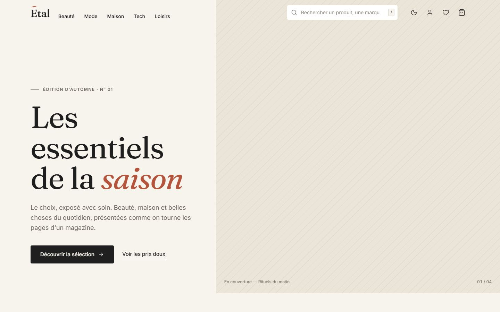

## Sommaire

- [Aperçu](#aperçu)
- [Fonctionnalités](#fonctionnalités)
- [Essayer la démo](#essayer-la-démo)
- [Stack](#stack)
- [Architecture](#architecture)
- [Choix techniques](#choix-techniques)
- [Qualité](#qualité)
- [Lancer le projet](#lancer-le-projet)
- [Déployer sur Vercel](#déployer-sur-vercel)
- [Limites connues](#limites-connues)

## Aperçu

| Catalogue                                              | Fiche produit                                  | Mini-panier                                    |
| ------------------------------------------------------ | ---------------------------------------------- | ---------------------------------------------- |
| 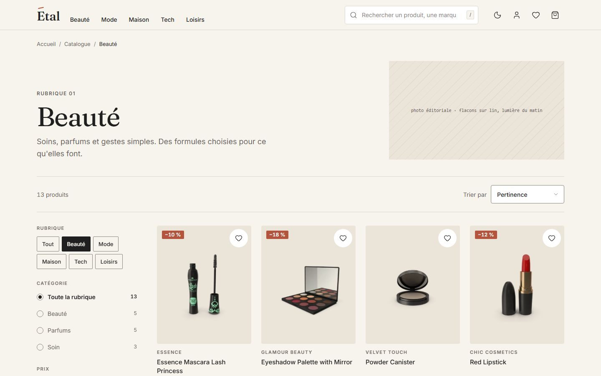 | 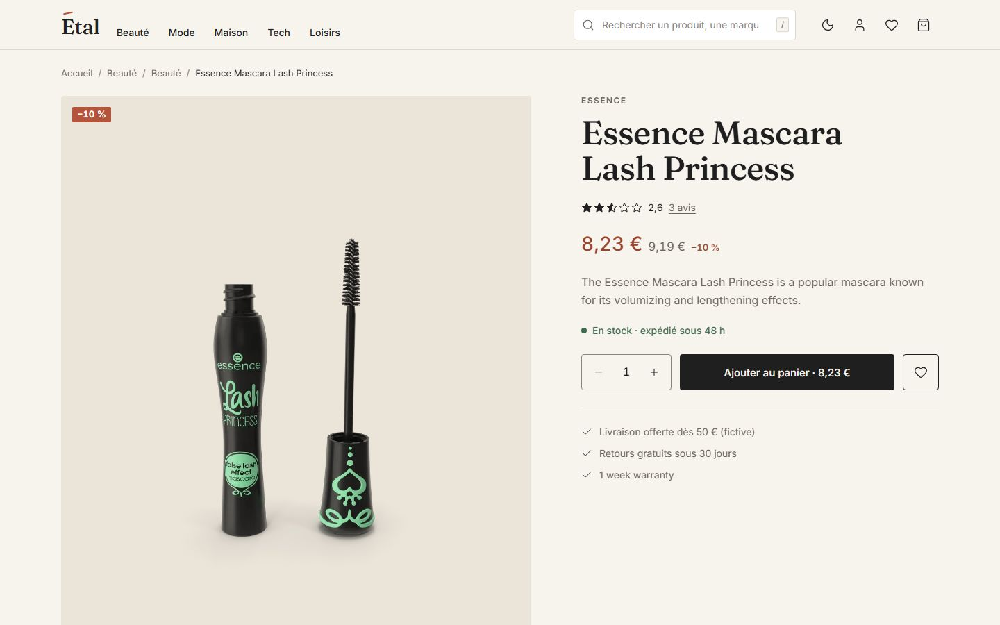 | 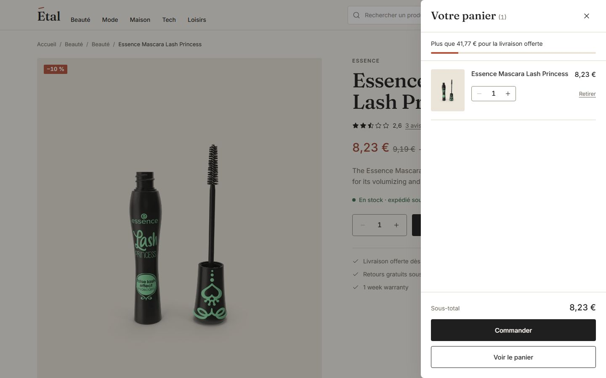 |

| Commande en 3 étapes                                 | Espace client                                  | Thème sombre                                                        |
| ---------------------------------------------------- | ---------------------------------------------- | ------------------------------------------------------------------- |
| 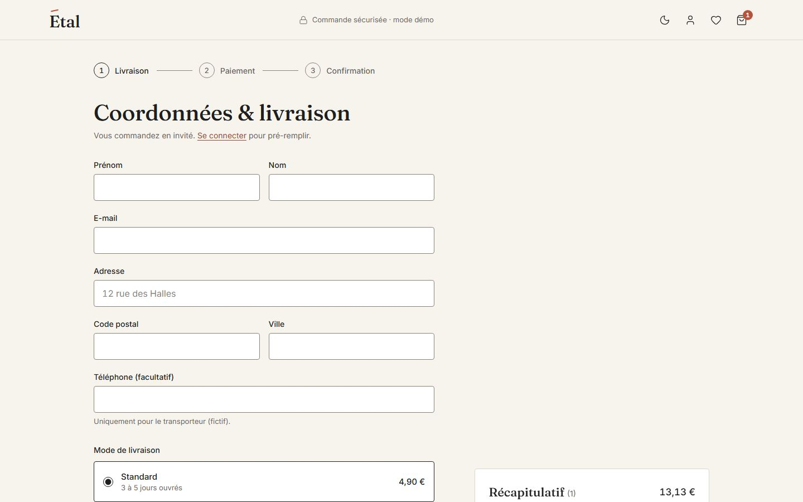 | 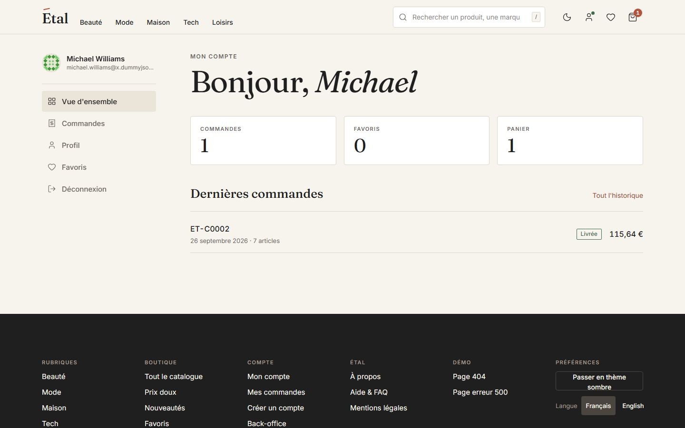 | 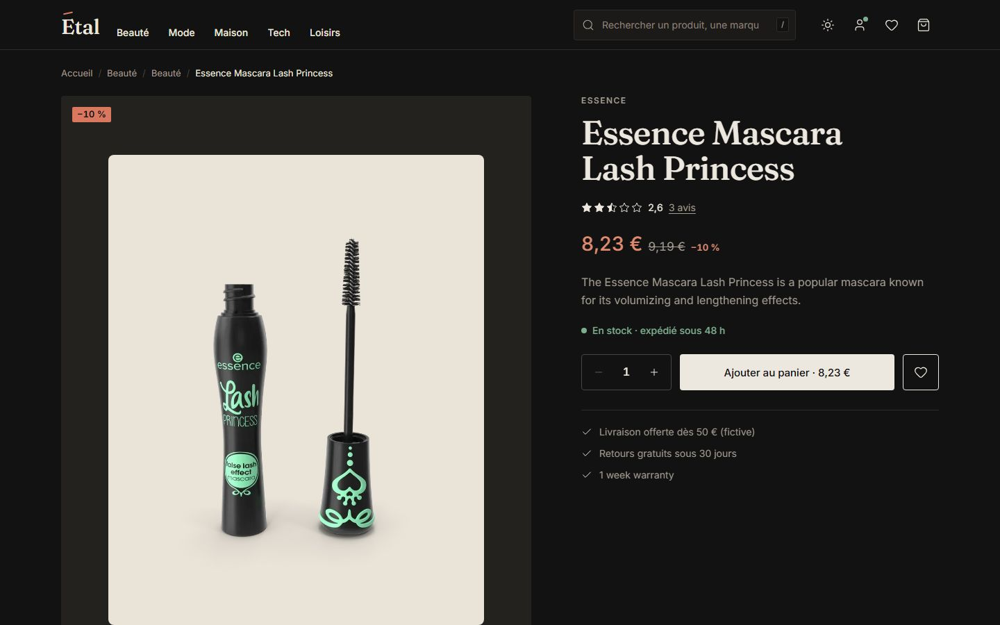 |

| Back-office · tableau de bord                                  | Back-office · formulaire produit                                                     | Back-office · thème sombre                                                      |
| -------------------------------------------------------------- | ------------------------------------------------------------------------------------ | ------------------------------------------------------------------------------- |
| 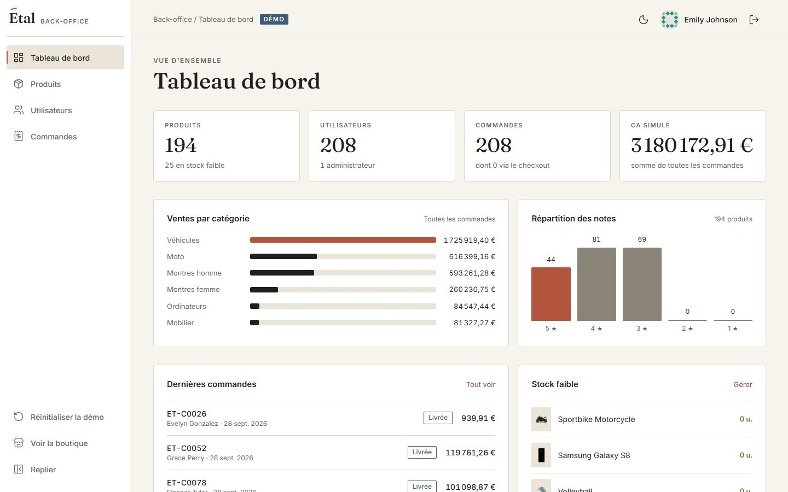 | 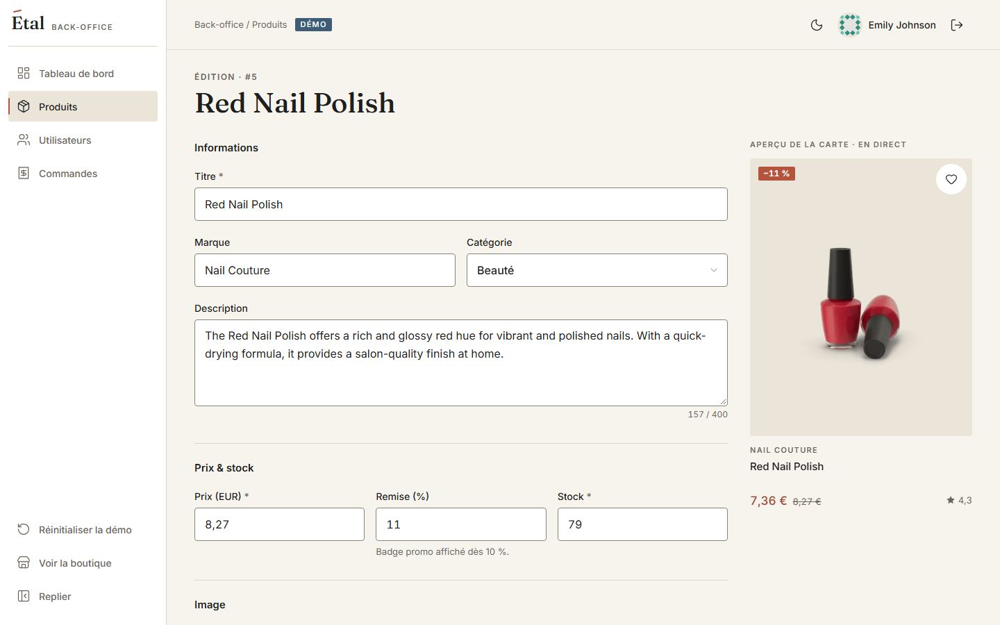 | 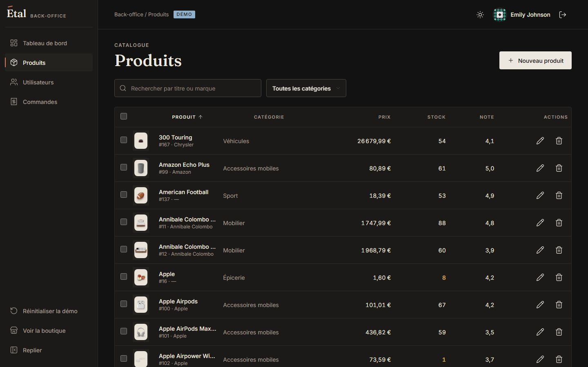 |

<p>
  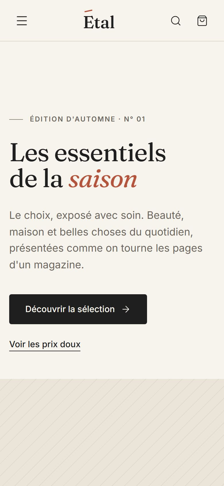
  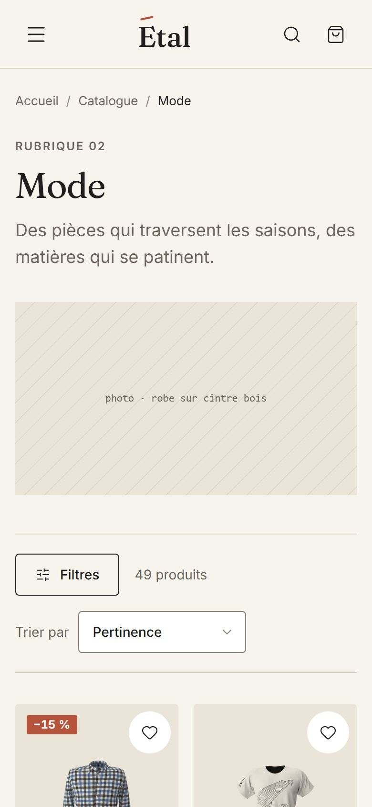
</p>

## Fonctionnalités

**Boutique**

- Accueil éditorial : rubriques, carrousels « Meilleures notes », « Prix doux » et « Nouveautés », newsletter.
- Catalogue filtrable (rubrique, catégorie, prix, note, marque, stock, promotion), trié et paginé, **état synchronisé dans l'URL** (partageable, compatible bouton retour).
- Recherche avec **suggestions en direct** (combobox ARIA, navigation clavier, raccourci `/`).
- Fiche produit : galerie avec zoom plein écran, onglets, avis clients, produits similaires, fil d'Ariane.
- Panier persistant avec mini-panier, livraison offerte dès 50 €, code promo `PORTFOLIO10`, annulation de suppression.
- Favoris, commande simulée en 3 étapes (coordonnées, paiement factice, confirmation).
- Pages À propos, FAQ, Mentions légales ; pages 404 et 500 personnalisées.

**Espace client**

- Connexion (comptes de démo en un clic, « se souvenir de moi », retour à la page d'origine), inscription avec indicateur de robustesse du mot de passe.
- Tableau de bord, profil modifiable, historique et détail des commandes (paniers de l'API + commandes passées sur le site).

**Back-office** (rôle administrateur, vérifié côté serveur)

- Tableau de bord : indicateurs, ventes par catégorie, répartition des notes, dernières commandes, stock faible.
- Produits : tableau avec recherche, filtre, tri, pagination, sélection multiple et suppression groupée ; formulaire validé avec **aperçu de la carte en direct**.
- Utilisateurs (rôle, suppression) et commandes (statut modifiable).
- Les écritures sont simulées par l'API : mise à jour optimiste, toast « mode démo », bouton « Réinitialiser la démo ».

**Partout** : français et anglais (`/en`), thème clair et sombre, responsive de 360 à 1536 px, navigation au clavier.

## Essayer la démo

| Compte          | Identifiant | Mot de passe   |
| --------------- | ----------- | -------------- |
| Cliente         | `michaelw`  | `michaelwpass` |
| Administratrice | `emilys`    | `emilyspass`   |

Les deux comptes se remplissent en un clic sur la page de connexion.

- **Paiement** : seule la carte de test `4242 4242 4242 4242` est acceptée (un bouton la remplit). Aucun numéro réel n'est accepté ni transmis.
- **Code promo** : `PORTFOLIO10` (−10 %).
- **Back-office** : `/admin` avec le compte administratrice.

## Stack

| Domaine             | Outils                                                                                                                       |
| ------------------- | ---------------------------------------------------------------------------------------------------------------------------- |
| Framework           | [Nuxt 4](https://nuxt.com) (Vue 3, Nitro), TypeScript strict                                                                 |
| Interface           | Tailwind CSS 4 (tokens du design system), [Reka UI](https://reka-ui.com) (primitives accessibles), Tailwind Variants, Lucide |
| État et formulaires | Pinia (+ persistance locale), VeeValidate avec Zod 4                                                                         |
| Authentification    | [nuxt-auth-utils](https://github.com/atinux/nuxt-auth-utils) (session scellée dans un cookie `httpOnly`)                     |
| Contenu             | `@nuxtjs/i18n` (FR/EN), `@nuxt/image` (AVIF/WebP), `@nuxt/fonts` (Fraunces, Inter auto-hébergées), `@nuxtjs/color-mode`      |
| Données             | [DummyJSON](https://dummyjson.com) : produits, utilisateurs, paniers, authentification JWT                                   |
| Tests               | Vitest (+ `@nuxt/test-utils`, happy-dom), Playwright, axe-core                                                               |
| Outillage           | ESLint (`@nuxt/eslint`), Prettier, Husky, lint-staged, commitlint, GitHub Actions                                            |

## Architecture

```
app/                    Interface
  components/ui/        Design system (boutons, champs, dialogues, tiroirs, toasts…)
  features/<domaine>/   Composants et composables par domaine : catalog, product, cart,
                        checkout, account, admin, home, pages
  pages/                Pages fines : elles assemblent des features
  stores/               Pinia : panier, favoris, commandes, surcharges admin
server/
  api/                  Routes Nitro /api/* — le navigateur ne parle jamais à DummyJSON
  adapters/dummyjson/   Seul code qui connaît l'API : client HTTP, schémas Zod, mappers
  catalog/              Filtres, tri et facettes appliqués côté serveur
  routes/               sitemap.xml et robots.txt générés
shared/                 Types de domaine, schémas Zod et utilitaires communs client/serveur
i18n/locales/           Traductions FR (défaut, sans préfixe) et EN (/en)
tests/                  unit · components · e2e · fixtures (réponses DummyJSON réelles)
```

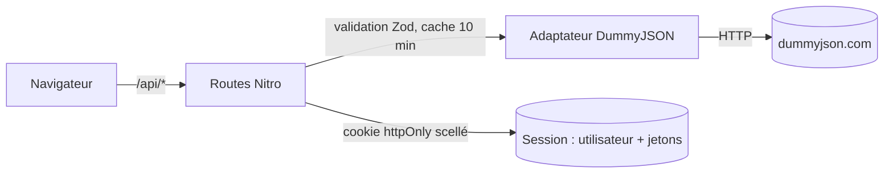

## Choix techniques

- **Un proxy Nitro devant l'API.** Toutes les requêtes passent par `/api/*`, qui valide les entrées avec Zod et ne renvoie que des types du domaine. DummyJSON est isolé dans `server/adapters/dummyjson/` : changer de fournisseur ne touche qu'un dossier.
- **Le catalogue filtré côté serveur.** DummyJSON ne sait ni filtrer par prix, note ou marque, ni trier par remise. Le catalogue complet (~200 produits) est mis en cache 10 minutes par Nitro, puis filtré et paginé à chaque requête : un seul appel à l'API pour toutes les combinaisons de filtres.
- **Des prix en entiers.** Les prix de l'API (USD décimaux) sont convertis côté serveur en centimes, dans une devise unique configurable dans `app.config.ts` (EUR par défaut, franc CFA possible). Aucun calcul de panier ne manipule de flottants.
- **Une session sans jeton dans le navigateur.** Les jetons JWT de DummyJSON restent dans la partie `secure` d'une session scellée (`nuxt-auth-utils`). Sur un 401, le serveur rafraîchit le jeton et rejoue la requête ; en cas d'échec, la session est fermée proprement.
- **Des rôles décidés côté serveur.** L'API marque plusieurs clients comme administrateurs ; Étal s'appuie plutôt sur une liste d'identifiants (`NUXT_ADMIN_USER_IDS`). Les routes `/api/admin/*` revérifient le rôle, en plus du middleware de navigation.
- **Des écritures simulées assumées.** L'API répond comme si elle enregistrait. Le back-office appelle vraiment l'API, puis garde l'effet dans un store en mémoire superposé aux données de l'API, et le dit à l'utilisateur.
- **Des schémas partagés.** Les mêmes schémas Zod valident les formulaires (via un adaptateur VeeValidate pour Zod 4) et les corps de requête côté serveur ; leurs messages sont des clés de traduction.
- **L'état du catalogue dans l'URL.** Filtres, tri et page vivent dans la query string : un lien se partage, le bouton retour fonctionne, et le serveur rend directement la bonne page.

## Qualité

| Vérification                                    | Résultat                                                                                                                                                          |
| ----------------------------------------------- | ----------------------------------------------------------------------------------------------------------------------------------------------------------------- |
| Typecheck (`vue-tsc`)                           | 0 erreur                                                                                                                                                          |
| ESLint + Prettier                               | 0 avertissement, aucune chaîne d'interface en dur                                                                                                                 |
| Tests unitaires et composants (Vitest)          | 158 tests                                                                                                                                                         |
| Couverture (shared, adaptateurs, stores, utils) | 89 % des instructions · 84 % des branches                                                                                                                         |
| E2E (Playwright, sur le build de production)    | 43 tests, desktop et mobile                                                                                                                                       |
| Accessibilité (axe)                             | 0 violation grave, thèmes clair et sombre, sur l'accueil, le catalogue, une fiche produit, le panier, la connexion, les pages annexes et le tableau de bord admin |

Les parcours E2E couvrent la recherche avec suggestions, la commande complète en invité, la connexion client jusqu'au détail d'une commande, la création d'un produit dans le back-office, et l'accès refusé au back-office pour un client (côté navigateur et côté serveur).

La CI GitHub Actions enchaîne, à chaque push sur `main` et chaque pull request : audit des dépendances, lint, typecheck, tests avec couverture, build et E2E.

## Lancer le projet

Prérequis : Node.js 22 ou plus récent.

```bash
cd etal
corepack enable          # fournit pnpm
pnpm install
cp .env.example .env     # le secret de session est généré au premier `pnpm dev`
pnpm dev                 # http://localhost:3000
```

| Commande                         | Rôle                                                  |
| -------------------------------- | ----------------------------------------------------- |
| `pnpm dev` / `build` / `preview` | Développement, build de production, aperçu du build   |
| `pnpm lint` / `format`           | ESLint + Prettier                                     |
| `pnpm typecheck`                 | `vue-tsc` sur l'app, le serveur et `shared/`          |
| `pnpm test` / `test:coverage`    | Vitest : projets `unit` (Node) et `nuxt` (composants) |
| `pnpm test:e2e`                  | Playwright + axe sur le build (`pnpm build` d'abord)  |

La page `/_ui` présente le design system (couleurs, typographie, composants et leurs états).

Les commits suivent [Conventional Commits](https://www.conventionalcommits.org), vérifiés par commitlint via Husky.

## Déployer sur Vercel

1. Importer le dépôt et choisir **`etal`** comme _Root Directory_ ; Vercel détecte Nuxt et pnpm.
2. Définir les variables d'environnement :

| Variable                       | Valeur                                                                                         |
| ------------------------------ | ---------------------------------------------------------------------------------------------- |
| `NUXT_SESSION_PASSWORD`        | Secret d'au moins 32 caractères (obligatoire en production)                                    |
| `NUXT_PUBLIC_SITE_URL`         | URL publique, ici `https://etal-ten.vercel.app` (canonical, sitemap, données structurées)      |
| `NUXT_PUBLIC_I18N_BASE_URL`    | Même URL (liens `hreflang`)                                                                    |
| `NUXT_ADMIN_USER_IDS`          | Identifiants DummyJSON administrateurs, `1` par défaut (compte `emilys`)                       |
| `NUXT_API_BASE_URL`            | Optionnel, `https://dummyjson.com` par défaut                                                  |
| `ENABLE_EXPERIMENTAL_COREPACK` | `1` si le build échoue sur la version de pnpm (le projet fixe la sienne dans `packageManager`) |

## Limites connues

- Les écritures (profil, inscription, back-office) ne sont pas persistées : c'est le comportement de DummyJSON, signalé dans l'interface.
- Le parcours E2E « accueil → filtre → fiche produit → panier » n'est pas encore automatisé.
- Non réalisés à ce stade : adresses et préférences dans l'espace client, synchronisation du panier avec l'API, bascule grille/liste du catalogue, export CSV du back-office.

## Crédits

Données produits, utilisateurs et paniers : [DummyJSON](https://dummyjson.com). Polices : Fraunces et Inter. Icônes : Lucide.
Projet portfolio réalisé par Syabe Technologies, 2026.
